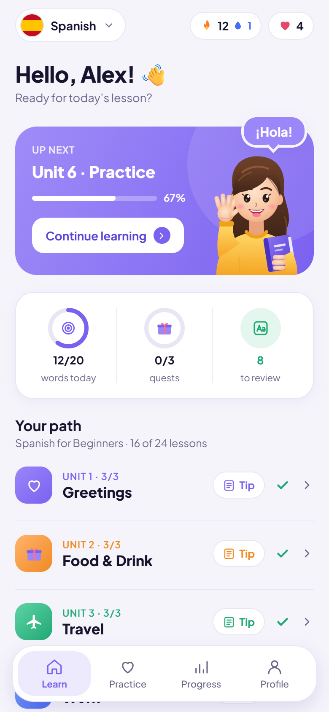
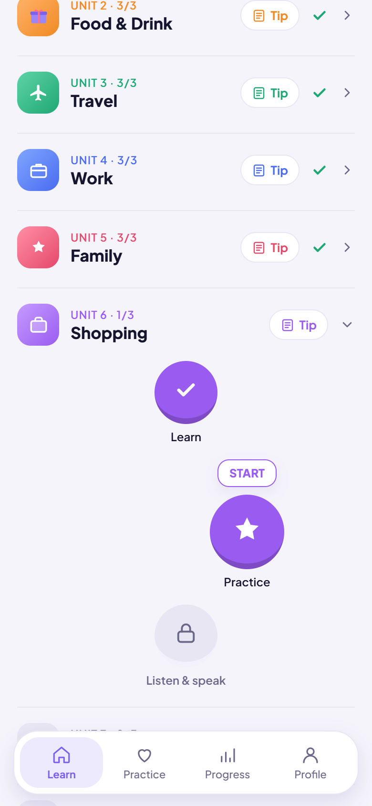
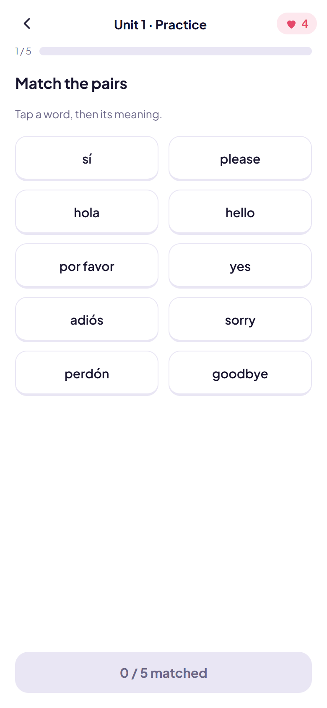
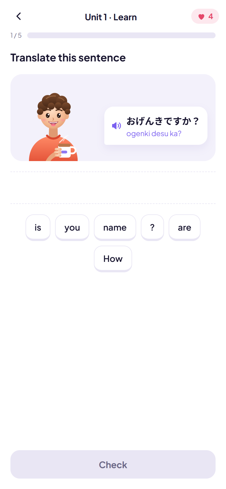

# Lingua

A React Native (Expo SDK 54) language-learning app for iOS, Android and the web: 16 languages (Spanish, French, Japanese, German, Korean, Chinese, Italian, Hindi, Portuguese, Dutch, Russian, Arabic, Turkish, Indonesian, Swedish, Polish), 12 units each (36 lessons), a learning path, spaced review, pronunciation scoring, an AI conversation tutor, daily quests, streaks and achievements. Light mode by default, with dark mode.

**[See all 59 screens →](docs/SCREENS.md)** · or open [docs/gallery.html](docs/gallery.html) in a browser (click any screen to enlarge)

<p>
  
  
  
  
</p>

## Run it

You need Node.js 20 or newer.

```bash
npm install
npx expo start          # press w for the web app, or scan the QR code with Expo Go
```

The web app runs everything, including pronunciation scoring in Chrome or Edge. On a phone, **Expo Go** runs everything except pronunciation scoring, which needs a development build (see below).

## Demo account

| Email | Password |
|---|---|
| `demo@lingua.app` | `Lingua@123` |

The login screen has a **Try the demo account** button. The demo account has sample progress, 8 words due for review, and a few badges already earned. New sign-ups choose a language, a daily goal and a starting point (from scratch or a placement test).

You can change your password and delete your account (with all its progress) under Settings → Account. Accounts are stored **on the device only** (password salted and SHA-256 hashed). There is no account server, so an account made on your phone does not exist in the browser. Replace `signIn` / `signUp` in `src/auth.js` with your backend when you add one.

## Features

**App layout:** four tabs. **Learn** has the language switcher, today’s goal, quests and review, the current unit and the whole learning path. **Practice** has review, skill drills and AI conversations. **Progress** has your level, streak week, XP, quests and badges. **Profile** has your account, library and all settings.

**Learning**
- **Learning path:** 12 units (Greetings, Food & Drink, Travel, Work, Family, Shopping, Weather & Time, Hobbies, Home, Health, Daily Routine, Feelings), with 3 lessons each: Learn, Practice, and Listen & speak. Lessons unlock in order. Tap a course to see its map.
- **Exercise types:** build the sentence, multiple choice, match the pairs, fill in the blank, type the answer, listen and type (dictation), and speaking. In non-Latin scripts, dictation becomes "listen and pick what you heard".
- **Placement test** when you add a language, to skip units you already know.
- **Spaced review:** every word you learn becomes a review card. Cards come back the next day, then after 3 days, then at growing intervals (SM-2 style). Missed cards come back within 10 minutes. Home shows "Review N words" when cards are due.
- **Pronunciation scoring** (0–100, coloured word by word; 60 passes).
- **Pronunciation guides:** romaji, pinyin with tone marks, and romanized Korean and Hindi under each phrase (Settings → Pronunciation guide). Japanese is taught in kana, and the romaji is generated from it.
- **Grammar tips:** one short tip with an example per unit and language (192 in all). Each tip opens the unit's Learn lesson and is also available from the Tip button on the learning path.
- **Word forms by gender:** setup asks how to address the learner, so Hindi, French, Portuguese and Korean teach the right forms (changeable in Settings).
- **AI conversation practice:** role-play scenes (one per unit) with a Claude-powered tutor that replies in the language, translates, corrects you gently and suggests replies. Needs the tutor server; see below.

**Motivation**
- **Hearts:** 5 hearts; each mistake in a lesson costs one. One refills every 30 minutes, and a review session earns one back.
- **Streaks and freezes:** a freeze is used automatically if you miss a day. You earn one every 7 streak days and by finishing all daily quests (max 2).
- **Daily quests:** 3 per day ("Earn 30 XP" plus two that rotate), +10 XP each.
- **XP levels and 10 achievements,** with a celebration and confetti when you earn one.
- **Daily reminders:** a local notification at your chosen time, "Your 12-day streak is waiting 🔥", skipped on days you've already practised. Phones only.

**Polish**
- Sound effects and haptics (both can be turned off), and offline mode. Lessons and review work offline, and a banner says when speech scoring and the tutor are unavailable.
- Fonts: Plus Jakarta Sans for the app. Hindi uses Noto Sans Devanagari, bundled. Japanese, Chinese and Korean use Noto Sans JP/SC/KR on the web, loaded from Google Fonts, and the phone's own font on iOS and Android (Android's is Noto). That avoids adding about 46 MB to the app.
- Accessibility: text size (Small to Extra large), reduced motion (in-app setting or the OS setting), and screen-reader labels and roles throughout.

## AI tutor server

```bash
cd server && npm install
ANTHROPIC_API_KEY=sk-ant-... npm start      # PowerShell: $env:ANTHROPIC_API_KEY="sk-ant-..."; npm start
```

The web app finds it at `http://localhost:8787`. On a phone, set **Settings → AI tutor server** to `http://<your computer's IP>:8787`. Details are in [server/README.md](server/README.md).

## Development build (pronunciation scoring on phones)

```bash
npm install -g eas-cli
eas build --profile development --platform android   # or ios
npx expo start --dev-client
```

## Content review

The course content has not been reviewed by native speakers yet. To produce a spreadsheet for reviewers (3,646 items), run:

```bash
node scripts/export-content.js     # writes content-review.csv
```

Apply the fixes in `src/content.js`.

## Phrase audio

The app plays a bundled audio clip for a phrase when there is one, and falls back to the device's text-to-speech voice when there isn't, so you can add audio one language (or one phrase) at a time. Clips live in `assets/audio/<lang>/`, named by a hash of the phrase (`src/audioKey.js`), and `assets/audio/index.js` lists them. No clips ship yet: every phrase currently uses the device voice.

```bash
node scripts/make-audio.mjs --list              # audio-recordings/recording-list.csv: every phrase, with the file name to save it as
node scripts/make-audio.mjs --import <folder>   # copy native-speaker recordings from <folder>/<lang>/<file>.mp3|m4a|wav
node scripts/make-audio.mjs --azure             # fill the gaps with Azure neural voices (AZURE_SPEECH_KEY, AZURE_SPEECH_REGION)
node scripts/make-audio.mjs                     # rebuild the index and print coverage per language
```

Add `--lang es,fr` to limit a run to some languages, `--force` to regenerate neural clips, and `--prune` to delete clips whose phrase was removed. Recordings always win: `--azure` never overwrites an imported recording. About 2,050 phrases cover all 16 languages (around 128 each). They fit easily in the free (F0) tier's monthly character allowance, but F0 allows about 20 requests a minute, so the script paces itself to 18 a minute: roughly two hours for everything, and it resumes where it stopped. On a paid (S0) resource, add `--rate 200`. After changing content, run `--list` again: a changed phrase gets a new file name.

## Releasing

See [store/LISTING.md](store/LISTING.md) for the store text, the submission checklist and the screenshots (`store/screenshots/`, 1290 × 2796). See [store/PRIVACY.md](store/PRIVACY.md) for a privacy policy template. Build with `eas build --profile production --platform all`.

## What's inside

```
App.js                 Shell: 4 tabs, back navigation, modals (lesson, add language, tutor), sheets, celebrations, reminders
src/content.js         Languages, units, sentences, word lists, feminine forms, role-play scenes
src/guides.js          Pronunciation guides (romanization) and grammar tips
src/fonts.js           Fonts for Japanese, Chinese, Korean and Hindi text
src/lessons.js         Builds lessons, drills, placement tests and review sessions
src/game.js            Rules: hearts, streaks/freezes, quests, XP levels, achievements, spaced repetition
src/data.js            Demo data and migration of older saved progress
src/store.js           Per-account progress (AsyncStorage) and actions
src/prefs.js           Device settings: theme, text size, reduced motion, sound, haptics, reminder
src/LessonScreen.js    Lesson engine with all exercise types
src/CourseMap.js       Learning path (units and lesson nodes)
src/Setup.js           Language picker for new learners
src/TutorScreen.js     AI role-play chat
src/Celebration.js     Badge / level-up / quest reward overlay
src/Sheets.js          Settings, hearts, streak, achievements, add course, profile
src/pronounce.js       Speech recognition, pronunciation scoring, typed-answer checking
src/reminders.js       Daily reminder notifications
src/fx.js              Sound effects and haptics
src/audio.js           Phrase audio: bundled clip if there is one, otherwise the device voice
assets/audio/          Phrase clips and their index (built by scripts/make-audio.mjs)
src/screens/           Learn (path), Practice, Progress, Profile tabs
src/AddLanguage.js     Add a language (opened from the language switcher)
src/ui.js              Shared layout pieces: headers, panels, pills, progress ring, tab bar
server/                AI tutor server (Claude API)
scripts/               Sound generator, content export, phrase audio builder
store/                 Listing, privacy policy, screenshots
docs/                  Screen gallery (SCREENS.md) and app screenshots
```

## Adding a language

1. Add it to `LANGS` in `src/content.js` (set `latin: true` for Latin scripts, `chars: true` for Japanese or Chinese style scripts).
2. Add a row to `ROWS` and a word list to `WORDS` for each of the 12 units, in the same order as `UNITS`.
3. Add 12 grammar tips to `TIPS` in `src/guides.js`. For a non-Latin script, also add pronunciation guides to `ROMAN` (or a converter, like Japanese and Russian) and the language code to `GUIDE_LANGS`.
4. If the speaker's gender changes some words, add the female forms to `FEMININE` in `src/content.js`.
5. If Plus Jakarta Sans lacks the script, add it to `scriptOf` in `src/fonts.js`.
6. Add its flag to `Flag` in `src/components.js`, and its name to `LANGS` in `server/tutor.mjs`.
7. Run `node scripts/export-content.js` and send the new rows to a native speaker for review.
8. Add its voice to `AZURE_VOICES` in `scripts/make-audio.mjs`, then run `node scripts/make-audio.mjs --list` to get its recording sheet.
